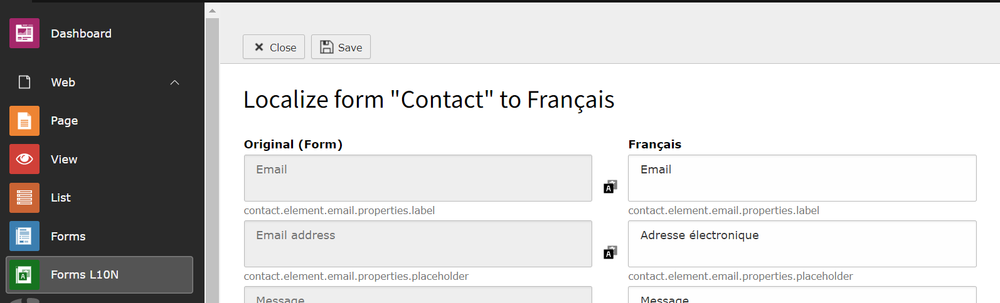

[](https://extensions.typo3.org/extension/form_translator/)
[](https://get.typo3.org/version/14)
[](https://get.typo3.org/version/13)
[](https://packagist.org/packages/r3h6/form-translator)
[](https://packagist.org/packages/form-translater)

# form_translator

This extension provides a backend module for translating TYPO3 form framework forms
and a cli for creating a source xliff file for a given form.




## Installation

Either from TYPO3 TER or through composer `$ composer req r3h6/form-translator`.

Requires TYPO3 13.4 or 14.2+ and PHP 8.2+.


## Integration

If you like use machine translation by [LibreTranslate](https://libretranslate.com/)
you must only configure an api host in the extension configuration.
See available [mirrors](https://github.com/LibreTranslate/LibreTranslate#mirrors).


## How it works

All forms share one translation file per language. By default they are stored in
`form_translations/` on FAL storage `1` (the `fileadmin/` storage):

```text
fileadmin/form_translations/locallang.xlf      # default language
fileadmin/form_translations/de.locallang.xlf   # German
fileadmin/form_translations/de_CH.locallang.xlf
```

Translation identifiers are prefixed with the form identifier, so a single file
holds the strings of every form. The extension registers the shared file for all
forms at runtime; the `*.form.yaml` files are not modified.

The directory can be changed with the `translationFilesDirectory` extension
setting, which expects a FAL combined identifier `<storageUid>:<path>` of a local
storage, for example `1:form_translations/`. When a form is deleted, its entries
are removed from the shared files.

Customized validation error messages are translated by overriding the form definition
at runtime. On TYPO3 v14 this uses the `AfterFormIsBuiltEvent` PSR-14 event; on TYPO3
v13 the `afterBuildingFinished` hook is used.

### Database-stored forms

On TYPO3 v14.2+ the extension supports all form storage adapters, including forms
stored in the `form_definition` database table. Their persistence identifier is the
numeric record UID; use it wherever a form identifier is expected, for example:

```bash
bin/typo3 form:create:xliff 42
```

Backend users of the Form Translator module need `tables_select` (and, for the form
manager, `tables_modify`) permission on `form_definition`. Unlike file mounts, database
storage currently provides no per-backend-group isolation, so every user with table
access can see all database-stored forms.


## Upgrade

### From v3

Run the install tool upgrade wizard "Migrate form translations to shared files"
(identifier `formTranslatorSharedTranslationFiles`). It moves the per-form XLIFF
files into the shared translation files and removes their registration from the
form definitions.

### From v2 an TYPO3 v12

Rename language files prefixed with a locale like `de_DE.locallang.xlf`
to the corresponding TYPO3 language `de.locallang.xlf`
or setup a [custom language](https://docs.typo3.org/m/typo3/reference-coreapi/main/en-us/ApiOverview/Localization/ManagingTranslations.html#xliff-translating-languages).

### From v2 an TYPO3 v11

No changes required.

## Development

```bash
ddev start
ddev composer install
ddev dev-setup
```

`ddev dev-setup` installs TYPO3 into an empty database, imports the development
site through `typo3 extension:setup`, and repairs the form persistence identifier
that impexp rewrites during the import. It is safe to run again; an existing
installation is kept and an already imported site is not imported twice.

Composer writes a `composer.lock` for local development (it is gitignored); TYPO3 v14's
Composer installer requires a lock file.

The backend admin is `admin` with password `Password$1` (development only).
The site configuration is generated from
`Build/dev-site/Initialisation/Site/main/config.yaml` into
`config/sites/main/config.yaml` on every run.

## Known issues

- [Issues on GitHub](https://github.com/r3h6/TYPO3.EXT.form_translator/issues)


## Resources

- [Tutorial by Sebastian Klein](https://www.sebkln.de/en/tutorials/translating-forms-in-the-typo3-form-framework/)
- [Translation with variants](https://docs.typo3.org/c/typo3/cms-form/main/en-us/I/Concepts/Variants/Index.html#concepts-variants-examples-translation)


## Develpment

### Events

| Name | Description |
|---|---|
| AfterParseFormEvent | Allows to change the translatable items of a form |
| FinalizeTypo3LanguagesEvent | Allows to change the available languages |

### Local setup

Setup libretranslate:

`docker run -ti --rm -p 5000:5000 -e LT_LOAD_ONLY='en,de' libretranslate/libretranslate`

LibreTranslate host:

`http://host.docker.internal:5000/`


## Contribution

Pull request are welcome!

__Please note__: I will not include other translation api's than LibreTranslate in this extension.
If you need an other service, you can create your own by implementing `TranslationServiceInterface`.
